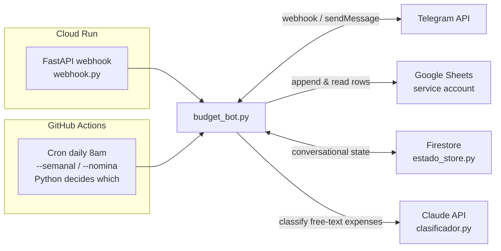
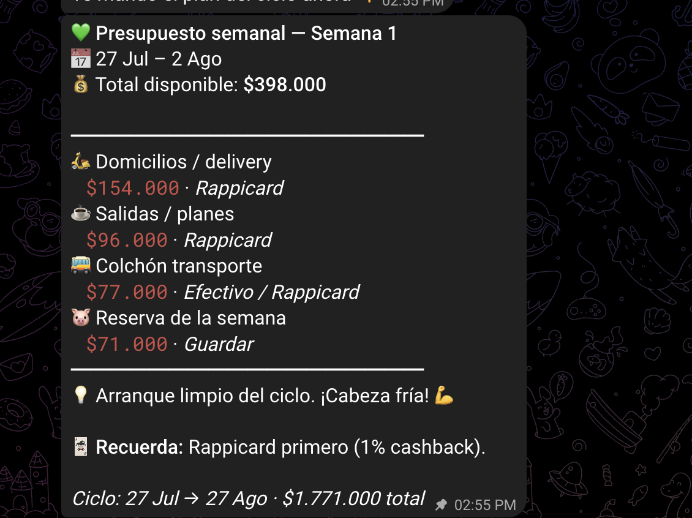
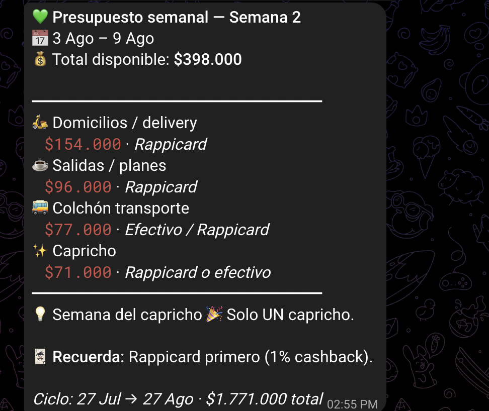

# 💚 Telegram Budget Bot

A conversational Telegram bot that guides you through your entire monthly pay cycle: it detects your payday, builds a weekly budget plan, listens for expense reports in natural language, records everything in Google Sheets, and proactively warns you before you overspend.

Serverless and instant: a **Cloud Run webhook** answers every message in real time, while **GitHub Actions** crons trigger the scheduled flows (payday, weekly budget).

## ✨ Features

- **Configurable payday** — The payday is a literal day of the month (e.g. the 17th), set once via a chat command ("ajuste en nómina") and stored in Firestore — no weekend/holiday adjustment.
- **Conversational cycle setup** — On payday, the bot asks for the Rappicard limit and the personal-spending budget — the only two amounts that are budgeted weekly — plus the balances of your digital *bolsillos* (pockets: groceries, transport, pet…). Rappicard + personal spending is split into 4 weekly budgets + a closing period; pockets are tracked visually and never budgeted. Create more with *"nuevo bolsillo Viajes 500000"*, move money with *"ingreso a mercado 50000"* / *"retiro de mascota 20000"*.
- **AI-powered expense tracking** — Send *"Hoy gasté 10.000 carro - cumple juanita"* and Claude (Anthropic API) extracts the amount, category label, payment method and note from free-form Spanish text. A deterministic regex parser is the fallback if the API call fails or no key is configured. The bot never asks follow-up questions: an expense in a pocket's category only debits that pocket; otherwise the payment method decides — Rappicard debits the card limit, anything else (or no method) debits personal spending.
- **Google Sheets ledger** — Every expense is appended to a spreadsheet via a service account; cashback is computed there as a formula (the bot records facts, not derivations).
- **Weekly budget messages** — A daily cron checks whether today starts a new budget week; if so, it sends that week's plan and asks whether you had money left over from the previous week — any surplus rolls into the new week's budget.
- **Buffer flow** — If you overspend a week, the bot offers to borrow a fixed buffer from next week's budget and adjusts both weeks.
- **Proactive 70% alert** — The moment your spending crosses 70% of the weekly budget, the bot warns you — once per week, no nagging.
- **Cycle closing report** — On payday, before starting the new cycle, you get a budgeted-vs-actual breakdown for Rappicard and personal spending, pocket balances, the most expensive week, and accumulated Rappicard cashback.
- **Pattern detection** — With 2+ complete cycles of history, the bot analyzes your ledger: dominant category, most expensive week of the cycle, highest-spending weekday, and average spend per cycle.

## 🧱 Architecture



Key design decisions:

- **Stateless runners, persistent state** — Neither GitHub Actions nor Cloud Run keeps memory between runs. Conversational state lives in Firestore (`estado_store.py`), shared by both without git race conditions.
- **One dispatcher, no blocking waits** — Every user message goes through `procesar_mensaje`. When the bot needs an answer (leftover money, buffer, payday), it sends the question, stores it as a pending question in Firestore and returns; the reply arrives later as a normal webhook call, so there are no timeouts, and expenses keep working in the meantime.
- **Webhook security** — The Cloud Run service is public (Telegram has no OAuth), so every request must carry Telegram's secret token (checked in constant time) and come from the configured chat; Telegram retries are deduplicated by `update_id`.
- **Broad crons, smart scripts** — Both payday and weekly checks run off the same daily cron; Python decides internally whether today is actually payday or the start of a budget week. The bot never needs manual reconfiguration between cycles.
- **Facts in Sheets, plans in state** — Google Sheets is the source of truth for expenses; Firestore holds the current cycle's budgets, pocket balances and pocket movements. Historical analysis reconstructs past cycles by recomputing each month's payday from the configured day.
- **AI with a deterministic fallback** — Expense interpretation never blocks on the user: if Claude is unavailable or unsure, the regex parser takes over, and an unknown category simply becomes "otros" (categories are only report labels).
- **Separation of concerns** — `budget_bot.py` handles Telegram and budget logic, `webhook.py` is the thin Cloud Run entry point, `sheets.py` isolates Google Sheets access, `estado_store.py` isolates Firestore access, `clasificador.py` isolates the Claude integration.

## 🛠️ Tech Stack

| Layer | Tool |
|---|---|
| Language | Python 3.11 (`asyncio`, `httpx`) |
| Messaging | Telegram Bot API (webhook) |
| Storage | Google Sheets (`gspread` + service account) — expense ledger |
| State | Firestore (`google-cloud-firestore`) — conversational/cycle state |
| Expense classification | Claude API (`anthropic`), with regex fallback |
| Real-time receiver | Google Cloud Run (FastAPI + Secret Manager) — see [docs/deploy-cloud-run.md](docs/deploy-cloud-run.md) |
| Scheduling | GitHub Actions (daily cron + `workflow_dispatch`) |

## 🚀 Setup

### 1. Clone and install

```bash
git clone https://github.com/AndreAVelez27/telegram-budget-bot.git
cd telegram-budget-bot
pip install -r requirements.txt
```

### 2. Create your Telegram bot

Talk to [@BotFather](https://t.me/botfather) to create a bot and get its token. Get your chat ID from [@userinfobot](https://t.me/userinfobot).

### 3. Set up Google Sheets access

1. Create a Google Cloud project and enable the **Google Sheets API**.
2. Create a **service account**, download its JSON key.
3. Create a spreadsheet with a `gastos` tab (columns: `fecha`, `monto`, `categoria`, `medio`) and share it with the service account's email.
4. Base64-encode the key: `base64 -i credentials.json`

### 4. Set up Firestore

Enable the **Firestore API** on the same (or another) Google Cloud project, create a database, and grant the service account from step 3 the `roles/datastore.user` role — it's reused for both Sheets and Firestore access via `GOOGLE_CREDENTIALS_B64`.

### 5. Get an Anthropic API key

Create a key at [console.anthropic.com](https://console.anthropic.com) for AI-powered expense classification. Without it, the bot falls back to a regex parser (unknown categories become "otros").

### 6. Configure environment

For local testing, create a `.env` file:

```env
TELEGRAM_TOKEN=your_botfather_token
TELEGRAM_CHAT_ID=your_chat_id
GOOGLE_CREDENTIALS_B64=base64_encoded_service_account_json
GOOGLE_SHEETS_ID=your_spreadsheet_id
ANTHROPIC_API_KEY=your_anthropic_api_key
```

For production, add the same values as **GitHub Actions secrets** (Settings → Secrets and variables → Actions).

### 7. Run

```bash
python3 budget_bot.py --nomina    # payday flow (asks for Rappicard, personal spending and pocket balances; only acts on the configured payday)
python3 budget_bot.py --semanal   # weekly budget (only acts if a week starts today)
python3 budget_bot.py --escucha   # manual polling fallback (only works while no webhook is set)
python3 budget_bot.py --resumen   # full cycle summary
python3 budget_bot.py --insights  # spending patterns (needs 2+ cycles of data)
python3 budget_bot.py --ajuste    # manual mid-cycle adjustment (real Rappicard + personal spending balances)
```

To change the configured payday, message the bot "ajuste en nómina" and reply with the day of the month (1–31).

The workflow in [.github/workflows/budget.yml](.github/workflows/budget.yml) runs these automatically and can also be triggered manually from the Actions tab with a mode selector.

## 📱 The bot in action

**Payday conversation** — the bot asks for Rappicard, personal spending and pocket balances, and builds the cycle _(screenshots pending refresh for v2)_:


**Weekly budget messages** — one per week, with the Rappicard / personal-spending split:




**Expense tracking** — report in natural language, get your updated balance:


## ⚠️ Known limitations

- Scheduled flows (payday, weekly budget) still run on GitHub Actions cron, which is best-effort and can start late during peak hours. Expense messages are not affected: they are handled instantly by the Cloud Run webhook.
- Single-user by design (one chat ID). Multi-user support is on the roadmap along with a Streamlit dashboard.
- Gmail/Outlook ingestion (auto-registering expenses from bank purchase-alert emails) is a planned follow-up, not yet implemented.

## 📄 License

[MIT](LICENSE)
